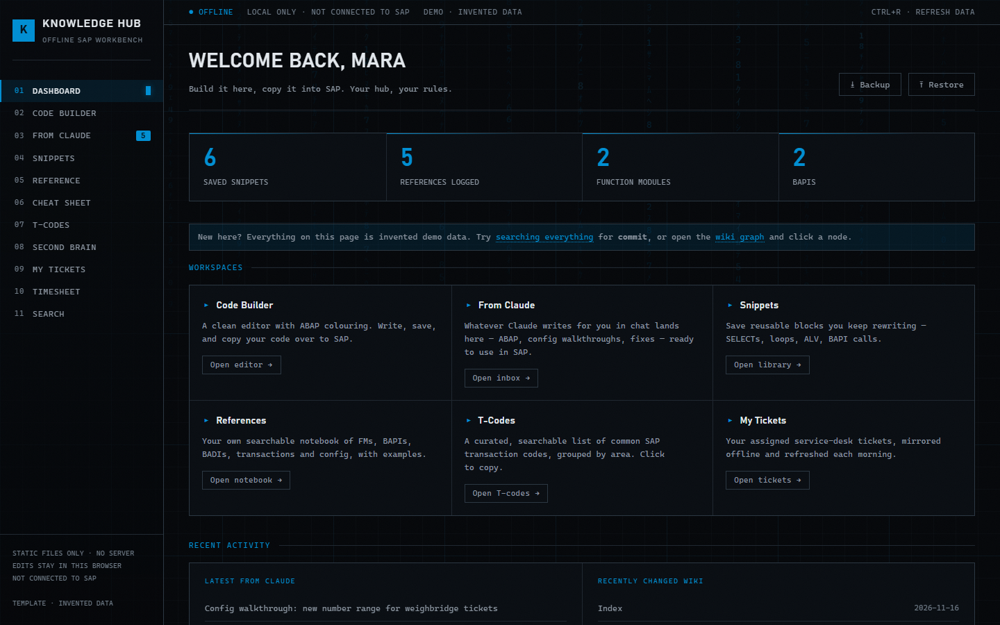
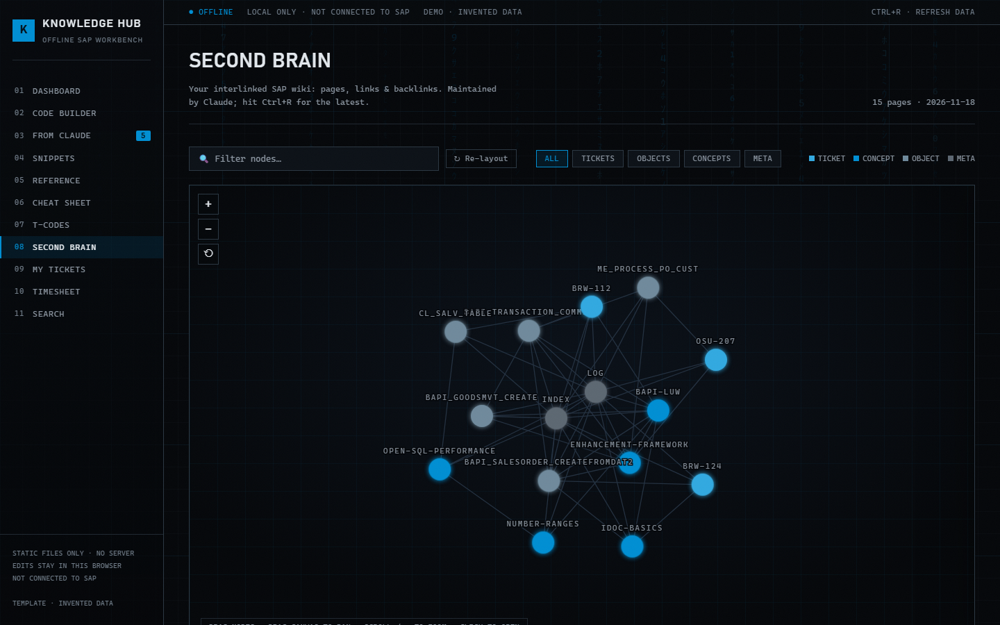
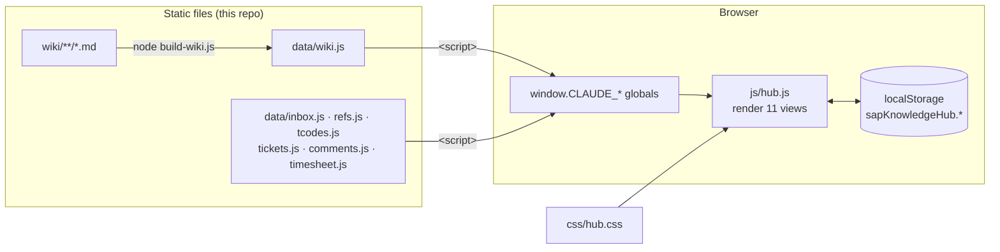

# SAP Knowledge Hub

An offline, zero-dependency workbench for SAP developers and consultants. It opens from a folder with a double-click: no server, no build step, no install, no network calls.

> **Sanitised template.** This is a public template of a tool I use day to day. All data in it is invented: the consultancy *Larkwell Consulting*, the clients *Brackenfield Waste* and *Osterby Utilities*, the systems BD1/BQ1/BP1, the tickets, the people and the timesheet. Any resemblance to real companies, people or tickets is coincidental. The SAP objects and transaction codes are standard, publicly documented SAP names; the explanations are written in my own words.

**Live demo:** [tacitdev1.github.io/sap-knowledge-hub](https://tacitdev1.github.io/sap-knowledge-hub/). Try [Search for "commit"](https://tacitdev1.github.io/sap-knowledge-hub/#search?q=commit), then open the [Second Brain graph](https://tacitdev1.github.io/sap-knowledge-hub/#wiki) and click a node.

**Code:** [github.com/TacitDev1/sap-knowledge-hub](https://github.com/TacitDev1/sap-knowledge-hub)



## What it does

Eleven views in one page:

| View | What it is |
|---|---|
| Dashboard | Counts, workspaces, recently changed wiki pages and inbox items |
| Code Builder | ABAP editor with syntax colouring and ready-made templates (SALV, BAPI + commit, guarded update report) |
| From Claude | An inbox for code and walkthroughs handed over from an AI chat session |
| Snippets | Your own reusable code blocks, editable in the page |
| Reference | A notebook of function modules, BAPIs, BAdIs and classes, plus a researched list you can copy into it |
| Cheat Sheet | Click-to-copy ABAP patterns |
| T-Codes | A searchable list of common transaction codes, grouped by area |
| Second Brain | A Markdown wiki with `[[links]]`, backlinks and a force-directed link graph |
| My Tickets | An offline mirror of assigned service-desk tickets with comment threads |
| Timesheet | A working week rebuilt from tickets; you only type the hours |
| Search | One box across the wiki, tickets, T-codes, inbox, references and snippets |

| Second Brain graph | Search |
|---|---|
|  |  |

## How it is built



- **Data as script tags.** Each data file sets one global (`window.CLAUDE_REFS = {...}`). Browsers load `<script src>` from `file://` without complaint, while `fetch()` of JSON would be blocked. That one choice is why the hub runs from a folder with no server.
- **Read-only data, local edits.** The data files are the "published" content. Anything you create in the page (snippets, notebook entries, the editor buffer, timesheet hours) is kept in `localStorage` under the `sapKnowledgeHub.` prefix, with Backup / Restore buttons on the dashboard.
- **No dependencies.** Plain HTML, CSS and one script. The wiki graph is a hand-written force simulation in SVG; the Markdown renderer is about 40 lines.
- **Relative paths only**, so the same files work from disk, from `localhost` and from a GitHub Pages sub-path.
- The `CLAUDE_*` names come from the original workflow, where an AI assistant refreshes the data files each morning. They are just global names; nothing here calls an AI service.

Design notes are in [DESIGN.md](DESIGN.md).

## Run it

Open `index.html` in a browser. That's it.

To check it the way GitHub Pages will serve it (under `/sap-knowledge-hub/`):

```bash
node scripts/serve.mjs
```

then open `http://localhost:5178/sap-knowledge-hub/`. Any view can be opened directly with a hash, for example `#wiki` or `#search`.

## Add your own content

| File | Global | Shape |
|---|---|---|
| `data/refs.js` | `CLAUDE_REFS` | `{ generatedAt, items: [{ type: "FM"\|"BAPI"\|"BADI"\|"CLASS", name, desc, code }] }` |
| `data/tcodes.js` | `CLAUDE_TCODES` | `{ generatedAt, items: [{ code, title, module, note? }] }` |
| `data/inbox.js` | `CLAUDE_INBOX` | `{ generatedAt, items: [{ title, note, code }] }` |
| `data/tickets.js` | `CLAUDE_TICKETS` | `{ generatedAt, items: [{ key, url?, status, type, priority, project, updated, summary, note? }] }` |
| `data/comments.js` | `CLAUDE_COMMENTS` | `{ generatedAt, threads: { "KEY-1": [{ a: author, d: date, t: text }] } }` |
| `data/timesheet.js` | `CLAUDE_TIMESHEET` | `{ generatedAt, secondClient, weeks: [{ label, days: [{ dow, date, note?, entries: [{ id, ref, refUrl, client, source, title, what }] }] }] }` |
| `data/wiki.js` | `CLAUDE_WIKI` | generated, see below |

Edit any data file by hand (it is plain JavaScript) and reload the page.

**Wiki pages** live in `wiki/` as Markdown:

```
wiki/
  index.md, log.md        -> type "meta"
  concepts/*.md           -> type "concept"
  objects/*.md            -> type "object"
  tickets/*.md            -> type "ticket"
```

Each page starts with a small front matter block (`type`, `updated`) and a `# Title`. Link pages with `[[page-name]]` or `[[page-name|label]]`; the name is the file name without `.md`. Then rebuild the bundle:

```bash
node build-wiki.js
```

Links become edges in the graph, and every page gets a "Linked from" list automatically. The Pages workflow runs the same build on every push.

## Repository layout

```
index.html            the app shell (11 views)
css/hub.css           the theme
js/hub.js             all behaviour
data/*.js             content, loaded as globals
wiki/                 Markdown source for the Second Brain
build-wiki.js         wiki/ -> data/wiki.js
scripts/serve.mjs     optional local server that mimics the Pages sub-path
scripts/leak-scan.mjs check that nothing private slipped in
docs/screenshots/     images used by this README and the portfolio
```

## Leak scan

This repo was cut from a private tool, so every push runs `scripts/leak-scan.mjs` (IP addresses, email addresses, cloud and webhook hosts, key-like strings, plus a private denylist of names kept as a repository secret) and gitleaks. Run it locally with:

```bash
node scripts/leak-scan.mjs
```

## Licence

MIT, see [LICENSE](LICENSE). SAP, ABAP and the names of SAP objects and transactions are trademarks or product names of SAP SE, used here only to describe what the tool works with. This project is not affiliated with SAP.
